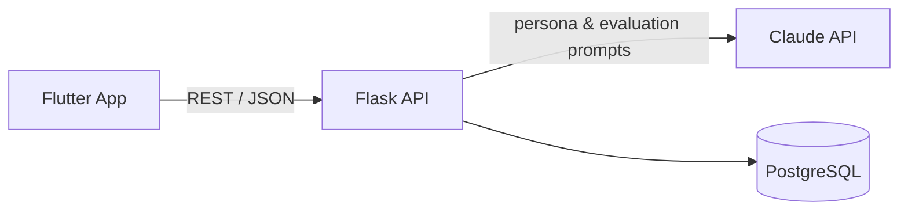

# OSCE Simulator — Backend API

Flask REST API that powers the [OSCE Simulator app](https://github.com/SadeemR/osce-flutter-app). It turns any clinical case into an AI-simulated patient, and grades the student's conversation against the university's own rubric.

> 🎓 Graduation project · Python + Flask + PostgreSQL + Claude API
> 🔗 Frontend repository: [osce-flutter-app](https://github.com/SadeemR/osce-flutter-app)

---

## What It Does

- **Dynamic patient persona** — builds a system prompt from the case fields (patient, complaint, findings, attitude, attached file), so it works for any case and any university.
- **Rubric-driven evaluation** — scores the conversation using the uploaded rubric's exact criteria, weights and maximum scores, and returns structured JSON. Falls back to the **SPIKES** protocol when no rubric is given.
- **Rubric parsing** — extracts criteria from an uploaded marking sheet.
- **Bilingual** — Arabic or English, following the case and rubric language.
- **Persistence** — stores students and evaluation results in PostgreSQL.

## Architecture



## API Endpoints

| Method | Endpoint | Description |
|---|---|---|
| `GET` | `/health` | Health check |
| `POST` | `/update-case` | Start a session with a new case (JSON) |
| `POST` | `/update-case-file` | Start a session with an attached case file (multipart) |
| `POST` | `/chat` | Send the doctor's message, get the patient's reply |
| `POST` | `/evaluate` | Grade the conversation against the rubric |
| `POST` | `/parse-rubric` | Extract criteria from a rubric file |
| `POST` | `/students/` | Add a student |
| `GET` | `/students/` | List students |
| `POST` | `/students/generate-prompt/` | Generate a persona prompt for a case |
| `POST` | `/save-result/` | Save an evaluation result |
| `GET` | `/results/` | List saved results |

## Tech Stack

Python · Flask · Flask-CORS · Gunicorn · PostgreSQL (psycopg2) · Anthropic Claude API · Railway

## Running Locally

```bash
git clone https://github.com/SadeemR/osce-backend.git
cd osce-backend
pip install -r requirements.txt

export ANTHROPIC_API_KEY="your-key"
export DATABASE_URL="postgresql://..."   # optional — database features are skipped without it

python app.py
```

Then open `http://localhost:8000/health`.

## Deployment

Deployed on Railway using the included `Procfile` (Gunicorn). Set `ANTHROPIC_API_KEY` and `DATABASE_URL` as environment variables — no secrets are stored in the code.

## Future Improvements

- Per-user session storage (conversation state is currently held in memory and shared)
- Authentication and rate limiting
- Automated tests

## Author

**Sadeem Mubarak** — [GitHub](https://github.com/SadeemR)
